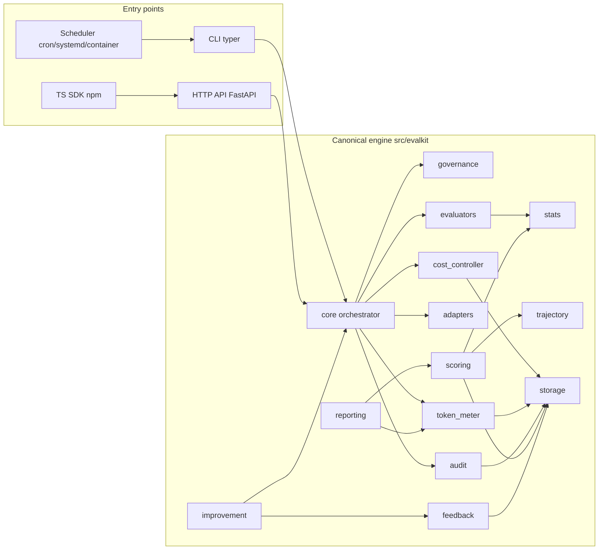

# Architecture

## 1. Shape

EVALKIT is a **modular monolith**: one Python package, one process by default, responsibilities
isolated behind documented ports (`*/interfaces.py`). No component exists to satisfy a name;
every package below has a concrete owner of behaviour or contracts. Distributed deployment
(API + workers) is a packaging choice on top of the same engine, not a different codebase
(ADR-0001).

## 2. Data flow of one campaign (V1 target)

1. **Plan** — `core` loads scenarios (`storage`), applies the profile (QUICK/STANDARD/DEEP/
   EXTENDED) and the smart-selection rules, asks `cost_controller.forecast`. In `DRY_RUN` the
   plan and estimated budget are rendered and nothing paid is called.
2. **Authorise** — `governance.decide` checks the action against the autonomy level;
   `cost_controller.reserve` performs an atomic check-and-reserve per run (storage-level lock).
3. **Execute** — `adapters.invoke` runs the agent. Output is untrusted data. Usage per call is
   captured with its source (REPORTED/ESTIMATED/UNKNOWN) and attributed by `token_meter`.
   Trajectory steps are stored for `trajectory` analysis.
4. **Evaluate** — `evaluators` run the scenario's `verifications`; each yields an
   `EvaluationResult` with control state *and* conclusion. LLM-assisted evaluators meter their
   own usage separately.
5. **Settle** — `cost_controller.settle` reconciles reserved vs observed cost; unused
   reservations are released. Every step emits `audit` events.
6. **Score** — `scoring` builds per-dimension scores with `stats` intervals; eliminatory
   failures are independent of any aggregate; validity controls add warnings.
7. **Report** — `reporting` renders JSON/CSV/Markdown/HTML from stored data only.
8. **Learn** — `feedback` opens tickets for failures; `improvement` runs the retrofit cycle in
   isolation and records verified learnings.

## 3. Module boundaries

| Package | Owns | Must not |
|---|---|---|
| `contracts` | Public data models, enums, JSON Schema export | import any other evalkit package |
| `core` | Campaign lifecycle, orchestration, resume | compute statistics or render |
| `adapters` | Agent/provider integration, usage capture | score, judge or persist |
| `evaluators` | Verification methods, evaluator registry, LLM-judge calibration hooks | aggregate across runs |
| `stats` | Intervals, comparisons, bootstrap, Monte-Carlo sampling, variance decomposition | know about budgets or storage |
| `trajectory` | Step collection, descriptive trajectory metrics (V2: Markov) | — |
| `token_meter` | Usage records, attribution, double-count-safe aggregation | price anything |
| `cost_controller` | Price registry use, forecasts, budgets, reservations, caps, alerts | call providers |
| `scoring` | Scorecards, weights per project, validity controls | render |
| `reporting` | Renderers (HTML/MD/JSON/CSV), charts, dashboard | invent values (no LLM in the path) |
| `audit` | Event emission, correction events, JSONL export, OTel bridge | drop or edit events |
| `feedback` | Tickets, incidents, dedup-with-history | decide fixes |
| `improvement` | Retrofit cycle, experiments, learnings KB | bypass governance |
| `scheduler` | Standalone execution plans and entrypoints | embed business logic |
| `governance` | Autonomy levels, permission checks, criteria-change control | be overridable by agents |
| `storage` | SQLite + JSONL + artifacts, migrations, transactions, locks | contain business rules |
| `cli`, `api` | Thin entry points over `core` | duplicate engine logic |

Dependency rule: `contracts` ← everything; `storage`/`audit` ← most; `core` is the only
package allowed to depend on all others. Nothing depends on `cli`/`api`.

## 4. Persistence (V1)

SQLite (WAL) for structured data with explicit migrations; JSONL for audit exports and
interchange; content-addressed artifact files for payloads subject to retention policy
(ADR-0002). The `Repository` port makes the backend interchangeable.

## 5. Statistics and uncertainty

`stats` is the only place where inference happens. Every result carries method, n,
assumptions and warnings; INCONCLUSIVE is a first-class outcome (ADR-0004).

## 6. Observability

Audit events map to OpenTelemetry GenAI semantic conventions where applicable
(`docs/OBSERVABILITY.md`); EVALKIT never invents a proprietary tracing model that cannot be
exported.

## 7. Distribution

Three distributions from one engine (ADR-0005): PyPI `graines-evalkit`, OCI image
`graines/evalkit` (CLI, API, worker modes), npm `@graines/evalkit` (API client + typed
contracts generated from the JSON Schemas; no statistics reimplemented).

## 8. Non-goals (V1)

No distributed queue, no multi-tenant SaaS, no live web app beyond static HTML reports,
no Markov estimation (V2), no adaptive scenario selection (V2).
